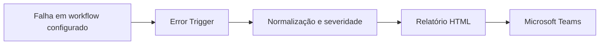
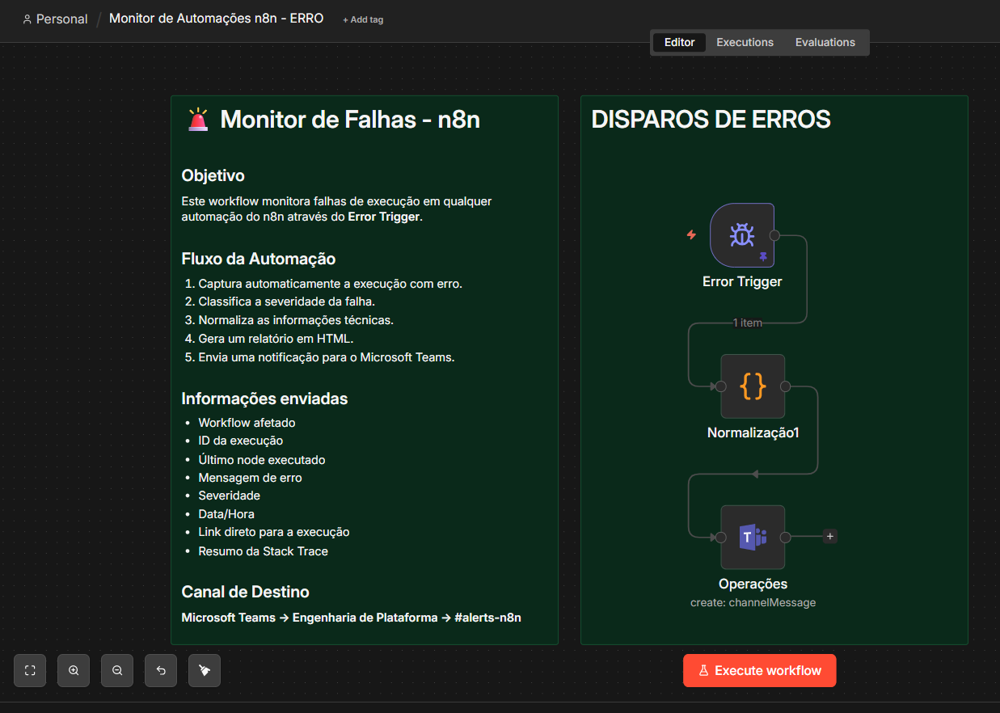

# Monitor de falhas — n8n e Microsoft Teams

Desenvolvi um monitor com **n8n Error Trigger, JavaScript, HTML e Microsoft Teams** para receber falhas, organizar informações técnicas e facilitar o início do diagnóstico.

## Como funciona

O Error Trigger recebe o evento de erro. O código normaliza as informações, classifica a severidade por regras textuais e monta um relatório HTML. O nó de Teams envia o alerta ao canal configurado.

O relatório inclui contexto do workflow, execução, nó, mensagem, data e hora, severidade, link para execução e resumo técnico quando disponíveis. A severidade representa uma heurística do código, não uma medição automática do impacto no negócio. O nó Teste já estava desativado no original.

**Não há agente de IA nem LLM neste projeto.** A preparação do alerta é feita em JavaScript e HTML.

O monitor não acompanha automaticamente toda a instância. Os workflows precisam apontar para ele em suas configurações de tratamento de erros. Confirmei esse vínculo nos três exports operacionais recebidos: entrada, enriquecimento e notificações. Removi o identificador privado na cópia pública; a associação deve ser refeita após importar o monitor.

## Screenshots

Envie os arquivos com os nomes acima para assets/screenshots/. Os links já estão preparados.

## Arquivos e reprodução

- [Template erros](workflows/erros.template.json) — 6 nós.
- [Inventário e códigos erros](docs/inventario-erros.md)
- [Arquitetura e vínculos](docs/arquitetura.md)
- [Configuração](docs/configuracao.md)
- [Preparação pública](docs/publicacao.md)
- [Validação](docs/validacao.md)

## Projetos conectados

- [Lead Guardian e enriquecimento — RD Station → Pipedrive](https://github.com/alosiolemos/n8n-rdstation-pipedrive-lead-guardian)
- [Notificações operacionais — CRM, Airbyte e Teams](https://github.com/alosiolemos/n8n-crm-airbyte-teams-notifications)

Os projetos documentam partes complementares da operação. Seus gatilhos e configurações devem ser associados na instalação de destino.
