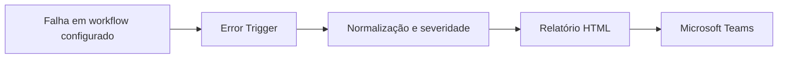

# Arquitetura e vínculos

Desenvolvi um monitor com **n8n Error Trigger, JavaScript, HTML e Microsoft Teams** para receber falhas, organizar informações técnicas e facilitar o início do diagnóstico.

## Como funciona

O Error Trigger recebe o evento de erro. O código normaliza as informações, classifica a severidade por regras textuais e monta um relatório HTML. O nó de Teams envia o alerta ao canal configurado.

O relatório inclui contexto do workflow, execução, nó, mensagem, data e hora, severidade, link para execução e resumo técnico quando disponíveis. A severidade representa uma heurística do código, não uma medição automática do impacto no negócio. O nó Teste já estava desativado no original.

**Não há agente de IA nem LLM neste projeto.** A preparação do alerta é feita em JavaScript e HTML.

O monitor não acompanha automaticamente toda a instância. Os workflows precisam apontar para ele em suas configurações de tratamento de erros. Confirmei esse vínculo nos três exports operacionais recebidos: entrada, enriquecimento e notificações. Removi o identificador privado na cópia pública; a associação deve ser refeita após importar o monitor.

## Fronteiras entre sistemas

| Vínculo | Informação transportada |
| --- | --- |
| RD → entrada | Contato e eventos de conversão; uuid para consulta |
| Entrada → Pipedrive | Dados normalizados; referências de pessoa e organização no lead |
| Pipedrive → enriquecimento | Identificador do lead informado no webhook |
| Evento CRM → notificações | Identificador do registro e campos do evento |
| Airbyte → notificações | Estado e contexto da sincronização |
| Workflow → monitor | Configuração errorWorkflow e evento de falha |

Esses vínculos são de integração por API e eventos, não relacionamentos de um modelo Power BI. Nem todas as ligações externas estão materializadas por chamadas diretas entre os JSONs.

O monitor recebe somente falhas elegíveis encaminhadas pelo n8n. Não implementei aqui uma fila de retentativas, compensação de transações ou garantia de entrega exatamente uma vez.
